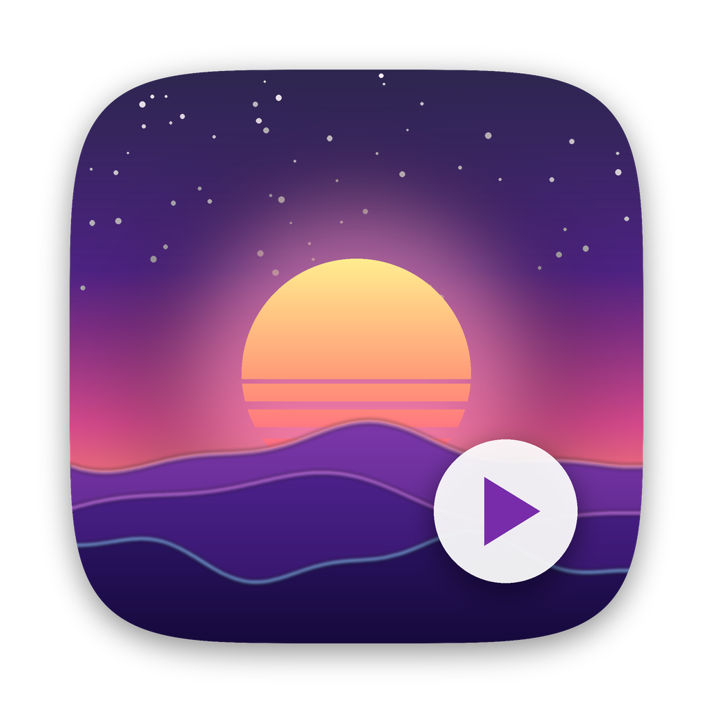

<p align="center">
  
</p>

<h1 align="center">LiveWallpaper</h1>

<p align="center">
  Живые видео-обои для macOS. Нативное, лёгкое, живёт в строке меню.<br>
  <sub>Live video wallpapers for macOS — native Swift app, menu bar only.</sub>
</p>

<p align="center">
  <b>Русский</b> | <a href="README.en.md">English</a>
</p>

<p align="center">
  
  
  
</p>

---

## Возможности

- 🎬 **Любое видео как обои** — mp4, mov, HEVC; бесшовный цикл через `AVPlayerLooper`
- 🖥 **Все мониторы и все рабочие столы (Spaces)** — окно под иконками рабочего стола, клики проходят насквозь
- 🔋 **Бережёт батарею** — автоматическая пауза, когда:
  - обои закрыты окнами или приложением на весь экран
  - экран заблокирован или погас
  - мак работает от батареи (отключается в меню)
- 🔇 Звук по умолчанию выключен, включается одним кликом
- ↔️ Режимы «заполнить экран» и «вписать без обрезки»
- 🚀 Запуск при входе в систему
- 🪶 Без Dock-иконки, без лишних окон — только значок ▶ в строке меню

## Установка

1. Скачай `LiveWallpaper-1.0.zip` со страницы [Releases](../../releases/latest).
2. Распакуй и перетащи **LiveWallpaper.app** в папку «Программы».
3. Приложение не нотарифицировано Apple, поэтому при первом запуске macOS его заблокирует. Выполни в Терминале:

   ```bash
   xattr -dr com.apple.quarantine /Applications/LiveWallpaper.app
   ```

   или открой **Системные настройки → Конфиденциальность и безопасность** и нажми **«Всё равно открыть»**.
4. Запусти приложение и выбери видео.

> Готовая сборка — только для Apple Silicon (M1 и новее). На Intel собери из исходников.

## Использование

Всё управление — через значок ▶ в строке меню:

| Пункт | Что делает |
|---|---|
| Выбрать видео… | Открывает выбор файла (⌘O) |
| Пауза / Продолжить | Ручная пауза (⌘P) |
| Звук | Включает звук видео |
| Вписать без обрезки | Показывает видео целиком вместо заполнения экрана |
| Пауза от батареи | Останавливать видео без зарядки |
| Запускать при входе | Автозапуск через `SMAppService` |

Выбранное видео и настройки запоминаются между запусками.

**Где взять обои:** любые зацикленные ролики — например, из [Moewalls](https://moewalls.com), [MotionBgs](https://motionbgs.com) или свои записи. Лучше всего работает HEVC (H.265): декодируется аппаратно и почти не грузит процессор.

## Сборка из исходников

Нужны только Command Line Tools (`xcode-select --install`), Xcode не обязателен.

```bash
git clone https://github.com/daniil7890/LiveWallpaper.git
cd LiveWallpaper
./build.sh
```

Скрипт соберёт `LiveWallpaper.app`, подпишет его ad-hoc подписью, установит в `~/Applications` и запустит. Можно также дважды кликнуть `build.command` в Finder — лог сборки сохранится в `build.log`.

## Как это устроено

- Для каждого экрана создаётся безрамочное окно на уровне `desktopWindow + 1` — над картинкой рабочего стола, но под иконками.
- Все окна показывают один общий `AVQueuePlayer`, поэтому видео декодируется один раз для всех мониторов.
- Видимость отслеживается через `NSWindow.occlusionState`, сон и блокировка экрана — через уведомления `NSWorkspace` и `com.apple.screenIsLocked`, питание — через `IOKit.ps`.

```
Sources/LiveWallpaper/main.swift   — всё приложение (~250 строк)
Info.plist                         — LSUIElement, иконка, bundle id
build.sh / build.command           — сборка .app
AppIcon.icns                       — иконка
```

## Лицензия

[MIT](LICENSE)
